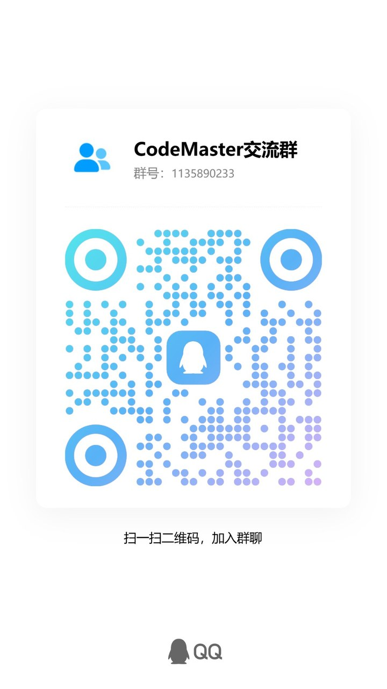

# CodeMasterAI


**说清业务，直接生成一套能独立维护的 .NET 10 + Vue 3 系统。**

内置 AI Agent 理解需求后直接建模——项目、模块、实体、字段、关系、控件——再生成后端服务、DTO、数据库迁移、权限菜单、国际化资源和前端页面。生成结果是**标准源码**，可以脱离本平台独立构建、部署和二次开发。

[官网](https://www.codemasterai.top) · [在线体验](https://www.codemasterai.top/index.html#/login) · [介绍视频](https://www.bilibili.com/video/BV1Cxg96nE73/) · [Gitee](https://gitee.com/cwj19851010/codemasterai) · [GitHub](https://github.com/cwj19851010/codemasterai) · [English](README.en.md)

> **最新版本修复了 10 余项编译与初始化问题。** 如果你之前在生成项目时遇到 `dotnet build` / `npm run build` 失败、初始化中断、登录 400 等情况，请拉取最新代码并重新导出模板后再试。具体修复项见 [版本更新说明](#版本更新说明)。

## 和传统低代码的区别

| | 传统低代码 | CodeMasterAI |
|---|---|---|
| 产出物 | 平台内的配置，导出受限 | 标准 ASP.NET Core + Vue 3 源码 |
| 能否脱离平台 | 通常不能 | 能，直接 `dotnet build` / `npm run build` |
| 二次开发 | 受限于平台提供的能力 | 就是普通工程，按需要改 |
| 复杂逻辑 | 拖拽表达不了就卡住 | 生成后手写，或继续让 Agent 改 |
| 数据与代码归属 | 常在平台方 | 全在你自己的数据库和仓库里 |

它更接近“一个按你的技术栈写项目骨架的工程师”，而不是“把你的业务装进别人盒子里的容器”。

## 从需求到可运行系统

```text
自然语言描述业务
      ↓
AI Agent 拆解为工作计划（实体 → 视图 → 关系 → 控件 → 复杂页面 → 一致性检查）
      ↓
逐阶段生成结构化变更集，写入项目元数据
      ↓
生成后端、前端、权限、菜单、国际化与迁移数据
      ↓
本地或服务端构建验证，失败自动分析并修复
      ↓
继续用自然语言增量迭代
```

也可以完全不用 AI：在实体设计器里手工建模，走同一条生成链路。

## 核心能力

### AI Agent：从描述到元数据

- **多阶段工作计划**：把一句需求拆成可确认、可断点续跑的工作计划，逐阶段执行，而不是一次性抛给模型一大坨改动。
- **结构化变更集**：Agent 不直接改文件，而是提交可校验的元数据变更集，非法变更在执行前被拦截。
- **字段类型回读**：每轮重新读取真实字段类型注入上下文，避免跨轮次用过期类型配置控件。
- **行业业务规则模板**：内置跨实体约束（如合同累计上限、入库后锁定、对账单次使用、对账金额上限），这类规则模型不会自己想到。
- **构建失败修复**：编译错误回灌给 Agent 分析并修复，而不是让人去读日志。
- **模型通道无关**：兼容 OpenAI 协议，可接任意兼容服务；CodeMaster 自身不配置代理，走系统环境变量。

### 代码生成：产出可脱离平台的源码

- **约定式建模**：定义实体、字段和关系后，自动生成服务、DTO、页面、菜单、权限、语言资源和迁移数据。
- **模板存数据库**：页面模板、字段控件模板、子表模板都可在界面里维护，改模板不用重新发版。
- **全量与增量**：既能从零生成完整项目，也能更新已有工程，并通过结构化脚本区尽量保留你的定制内容。
- **孤儿清理**：实体删除后残留的生成文件按纵向切片清理，避免旧文件把工程编译搞红。

### 多端交付

- **Web 管理端**：Vue 3 + Element Plus，含列表、表单、详情、子表卡片与弹窗。
- **微信小程序**：同一套元数据生成小程序页面，主表详情内嵌子表区块。
- **桌面客户端**：Tauri + LocalAgent，可打开远程部署的前端，同时调用**本地**数据库和本地大模型，代码生成全部在本地完成。

### 企业底座

- **动态 API**：应用服务按约定自动暴露 REST 接口，减少重复 Controller。
- **自动权限**：根据服务、菜单、按钮自动维护权限编码。
- **多租户与数据权限**：租户上下文、JWT 租户声明、部门数据范围过滤。
- **多数据库**：SQL Server、MySQL、PostgreSQL、SQLite、Oracle，按项目部署环境切换。
- **技术栈**：ASP.NET Core、SqlSugar、EF Core Migrator、SignalR、Quartz、Redis 可选缓存。

## 产品截图

### 项目实体管理


### 模板配置


### 实体设计器


## 演示视频

[](https://www.bilibili.com/video/BV1Cxg96nE73/)

[在 Bilibili 观看《自带 Agent 的全新低代码快速开发平台》](https://www.bilibili.com/video/BV1Cxg96nE73/)（2 分 24 秒）

视频展示可视化建模、Vue 3 页面设计、完整代码生成、增量更新、内置 Agent、MCP 连接和多数据库支持。视频发布时项目名为 CodeMaster，与现在的 CodeMasterAI 是同一项目。

## 适用场景

- 企业后台、ERP、CRM、MES、WMS 等数据密集型管理系统
- 需要统一权限、菜单、字典、多租户和审计能力的内部平台
- 希望沉淀自有开发框架、控件模板和代码规范的技术团队
- 需要让 AI 通过结构化工具参与建模、生成和维护的工程场景

## 项目结构

```text
CodeMaster.WebApi          ASP.NET Core API、动态 API、Controller、中间件
CodeMaster.Application     应用服务、DTO、代码生成、模板相关业务
CodeMaster.Agent           AI Agent：会话编排、工作计划、变更集、工具与业务规则
CodeMaster.Domain          领域实体
CodeMaster.Infrastructure  SqlSugar、仓储、认证授权、SignalR、Quartz、中间件
CodeMaster.Core            基础实体、接口、公共抽象
CodeMaster.Migrator        EF Core 迁移和种子数据
CodeMaster.Vue             Vue 3 管理端和 Tauri 客户端源码
CodeMaster.LocalAgent      桌面客户端使用的本地 sidecar 服务
CodeMaster.McpServer       面向 AI 代码生成流程的 MCP 服务
Templates                  生成项目使用的源码模板包
```

## 快速开始

开始前请安装 .NET SDK 10 与 Node.js 20+。默认使用 SQLite，克隆后无需安装任何数据库即可运行；要换成 MySQL 等数据库见下文「切换数据库」。

1. 创建本地配置（仓库只提交示例配置，不含真实密码）：

```powershell
Copy-Item CodeMaster.WebApi/appsettings.example.json CodeMaster.WebApi/appsettings.json
Copy-Item CodeMaster.Migrator/appsettings.example.json CodeMaster.Migrator/appsettings.json
```

示例配置默认 `DbProvider=Sqlite`，连接串为 `Data Source=../CodeMaster.db`。两个项目目录同级，会指向仓库根目录下的同一个数据库文件，不需要改动任何值。

2. 还原并构建：

```bash
dotnet restore CodeMaster.sln
dotnet build CodeMaster.sln
```

3. 初始化数据库（建表并写入种子数据）：

```bash
cd CodeMaster.Migrator
dotnet run
```

`CodeMaster.Migrator` 的 `DbProvider` 默认值为 `Sqlite`，与示例配置一致，不需要额外传参。如果之前用其它数据库构建过，先执行 `dotnet build -p:DbProvider=Sqlite` 重新编译。

4. 启动后端：

```bash
cd CodeMaster.WebApi
dotnet run
```

5. 启动前端：

```bash
cd CodeMaster.Vue
npm install
npm run dev
```

默认开发账号：

```text
admin / admin123
```

## 切换数据库

`CodeMaster.WebApi` 根据配置文件中的 `DbProvider` 在运行时选择 SqlSugar Provider；`CodeMaster.Migrator` 还需要使用相同名称的 MSBuild 属性进行构建。

| 数据库 | `DbProvider` / 构建属性 |
| --- | --- |
| SQL Server | `SqlServer` |
| MySQL | `MySql` |
| PostgreSQL | `PostgreSQL` |
| SQLite | `Sqlite` |
| Oracle | `Oracle` |

例如使用 PostgreSQL：

```bash
cd CodeMaster.Migrator
dotnet build -p:DbProvider=PostgreSQL
dotnet run --no-build
```

迁移程序的构建属性、Migrator 配置和 WebApi 配置必须指向同一种数据库。切换数据库后应重新构建迁移程序，并在目标数据库上验证迁移和种子数据。

EF 迁移文件不提交到仓库。首次初始化依赖空库检测：空库直接按当前模型建表并写入种子数据，因此克隆后无需生成迁移；只有对已有数据的库做结构升级时，才需要自行生成并验证迁移。

## 配置说明

请不要提交真实生产密钥。推荐使用：

- 环境变量
- 本地 user secrets
- 被 `.gitignore` 忽略的 `appsettings.Production.json`
- 服务器密钥管理服务

常用配置键：

```text
ConnectionStrings__DefaultConnection
DbProvider
JwtSettings__SecretKey
Authentication__GitHub__ClientId
Authentication__GitHub__ClientSecret
Authentication__GitHub__CallbackUrl
Email__Smtp__UserName
Email__Smtp__Password
Email__CodeSecret
```

Vue/Tauri 客户端需要自定义服务地址时，可复制 `CodeMaster.Vue/.env.example` 为本地 `.env`。

## 代码生成约定

- 不建议手工修改生成的 `.vue` 和 `.auto.js` 文件，重新生成时可能被覆盖。
- 模板变更应同步维护数据库种子数据；一次性的本地修复或更新脚本不要提交到仓库。
- 实体设计器以 `.tree.json` 作为页面结构来源。
- `.fields.json` 用于保留字段级脚本配置，支持增量生成。

## 桌面客户端

> 特别注意：如果服务端部署在远程服务器，请通过桌面客户端打开远程部署的 Vue 前端地址。客户端有调用本地数据库和本地大模型的能力，所有代码生成都在本地电脑上完成。

CodeMasterAI 的 Tauri 客户端用于连接服务端前端，同时通过 LocalAgent 调用本地能力。典型场景：

- 在客户端中打开部署在服务器上的 CodeMasterAI 前端
- 调用本地 sidecar 执行项目初始化和代码生成
- 启动本地生成项目的前端和后端
- 下载和管理生成模板

客户端安装包由 GitHub Actions 跨平台构建。推送 `v1.0.1` 形式的 Git Tag 后，工作流会自动生成 Windows x64、macOS Intel、macOS Apple Silicon、Linux x64 和 Linux ARM64 安装包，并上传到对应的 GitHub Release。也可以在仓库的 `Actions` 页面选择 `Release CodeMaster Client` 手动输入版本号运行。

```bash
git tag v1.0.5
git push github v1.0.5
```

客户端不内置项目模板 ZIP。安装后可在项目列表点击“下载模板”，由 LocalAgent 将服务器上的最新模板保存到本地模板目录。

## MCP 场景

CodeMasterAI MCP Server 面向自然语言代码生成工作流，例如：

- 新增或编辑项目、模块、实体
- 维护实体字段和控件属性
- 初始化生成项目
- 执行全量或增量代码生成
- 启动生成项目的前后端服务
- 查看生成项目的整体实体结构

涉及项目元数据的操作，推荐通过 MCP 工具完成，而不是让智能体直接编辑生成项目的元数据文件。

## 安全提醒

公开仓库或生产部署前请务必：

- 轮换所有曾经出现在源码、日志、截图或聊天记录里的密钥
- 不要提交生产 `appsettings`、`.env`、证书和数据库备份
- 生产环境默认关闭或保护 Swagger
- 使用 HTTPS 和足够强的 JWT 密钥
- 对可编辑模板、上传文件和生成代码流程做权限控制

漏洞报告请查看 [SECURITY.md](SECURITY.md)。

## 版本更新说明

当前版本：**v1.1.0**（2026-11-29 发布） · 完整修复清单见 [CHANGELOG.md](CHANGELOG.md)

### 2026-11 版本：集中修复生成项目的编译与初始化问题

这一版主要在收拾社区反馈里最多的一类问题——**生成出来的项目编译不过、初始化跑不完**。已修复的问题清单：

**生成项目编译**

- 开源版模板不再引用私有打印模块，修复 `CS0234: 命名空间 SeedData.CodeGen 中不存在类型`
- 开源版模板补齐 `CodeMaster.Vue/src/utils/printReport.js` 占位实现，修复 `vite build` 报 `Could not load .../printReport`
- 初始化时自动清理历史模板包里的孤立种子引用，旧模板也能构建通过

**初始化与数据库**

- 合并为单一 `DbContext` 并改为 EF 模块扫描，`Add-Migration` 不再报 `More than one DbContext was found`
- 修正 SQLite 相对路径的工作目录，Migrator 与 WebApi 指向同一个数据库文件，修复「初始化完没有种子数据、登录 400」
- 修复 Agent 批次适配器重复注册导致的 `An item with the same key has already been added: project_change_set`

**建模与生成**

- 编译器在实体阶段提前补齐关系外键字段，修复 `references missing target field` / `uses removed or renamed target field`
- 补齐 `system` / `monitor` 两个顶级目录的多语言翻译，菜单不再回退显示英文 key
- 模板 include 清单修正（`appsettings.Development.json` → `appsettings.example.json`），导出不再中途失败

**界面结构**

- 移除「数据源管理」，实体 / 视图 / API 收归「代码管理」
- 菜单顺序调整为：项目、模块、实体、视图、API、复杂页面、模板配置、组件管理

### 升级到本版本

1. 拉取最新代码（Gitee 与 GitHub 已同步）
2. 重新导出模板；或删除 `Templates/CodeMaster_Template_*.zip` 后重新生成
3. 已经生成过的项目建议重新初始化，或对照上面的修复项手动处理

如果仍然编译不过，请附上完整的 `dotnet build` / `npm run build` 输出提 Issue，方便定位。

## 路线图

- 提升 Agent 在复杂业务规则下的建模准确率
- 完善业务规则模板库，覆盖更多行业
- 完善 MCP 工具能力和文档
- 改进 Tauri 客户端安装、升级和模板下载流程
- 补充更多测试和示例项目

## 参与贡献

欢迎提交 Issue 和 Pull Request。较大的功能变更建议先开 Issue 讨论设计方向。

贡献前请阅读 [CONTRIBUTING.md](CONTRIBUTING.md)。

## 交流与反馈

- 问题与需求：[Gitee Issues](https://gitee.com/cwj19851010/codemasterai/issues) · [GitHub Issues](https://github.com/cwj19851010/codemasterai/issues)
- QQ 交流群：**1135890233**（扫码或直接搜索群号加入）

  

- 微信群与商务合作：[联系我们](https://www.codemasterai.top/contact)
- 提编译类问题时请附完整的 `dotnet build` / `npm run build` 输出，以及生成项目使用的模板版本

## 开源协议

CodeMasterAI 基于 [Apache License 2.0](LICENSE) 开源。

> 项目品牌已由 CodeMaster 更新为 CodeMasterAI。为保持现有工程兼容性，解决方案、命名空间和部分客户端标识暂时保留 `CodeMaster.*`。
